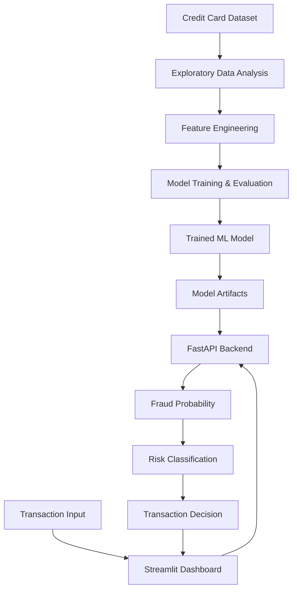

# 🔐 Real-Time Financial Fraud Detection & Risk Analytics System

An end-to-end Machine Learning project that detects potentially fraudulent credit card transactions, estimates fraud probability, assigns risk levels, and provides actionable transaction decisions through a FastAPI backend and an interactive Streamlit dashboard.

The system combines data analysis, feature engineering, machine learning, model evaluation, risk scoring, API development, and interactive analytics into one application.

---

## 🚀 Project Overview

Financial fraud detection is a critical challenge because fraudulent transactions represent a very small proportion of total transactions, making accurate identification difficult.

This project aims to identify suspicious credit card transactions using machine learning and convert model predictions into understandable risk categories and business decisions.

### Key Features

- **Exploratory Data Analysis:** Analyze transaction distributions, patterns, and class imbalance.
- **Feature Engineering:** Prepare model-ready features and transform transaction amounts.
- **Machine Learning:** Train and evaluate fraud classification models.
- **Fraud Probability:** Estimate the probability that a transaction is fraudulent.
- **Risk Scoring:** Categorize transactions into four risk levels.
- **FastAPI Backend:** Provide real-time prediction through a REST API.
- **Streamlit Dashboard:** Interactive interface for transaction analysis and model insights.
- **Transaction Analytics:** Maintain prediction history during the current dashboard session.

---

## 🏗️ System Architecture



---

## 🛠️ Technology Stack

| Category | Technologies |
|---|---|
| Programming Language | Python |
| Data Analysis | Pandas, NumPy |
| Data Visualization | Matplotlib, Seaborn |
| Machine Learning | Scikit-learn |
| Model Serialization | Joblib |
| Backend Development | FastAPI |
| API Server | Uvicorn |
| Frontend | Streamlit |
| Development Environment | Jupyter Notebook, VS Code |
| Version Control | Git, GitHub |

---

## 📂 Project Structure

```text
fraud-risk-system/
│
├── api/
│   └── app.py
│
├── artifacts/
│   ├── fraud_model.joblib
│   └── model_metadata.json
│
├── data/
│   └── raw/
│       └── creditcard.csv
│
├── notebooks/
│   ├── 01_eda.ipynb
│   ├── 02_feature_engineering.ipynb
│   └── 03_baseline_model.ipynb
│
├── streamlit_app.py
├── requirements.txt
├── README.md
└── .gitignore
```

**Note:** The original dataset is not included in this repository because of its large file size.

---

## 📊 Dataset

This project uses the Credit Card Fraud Detection dataset.

**Dataset source:** [Kaggle – Credit Card Fraud Detection](https://www.kaggle.com/datasets/mlg-ulb/creditcardfraud)

The dataset contains European credit card transactions made by cardholders over two days.

### Dataset Features

- `Time`: Seconds elapsed between each transaction and the first transaction.
- `V1` to `V28`: Anonymized transaction features obtained through PCA transformation.
- `Amount`: Transaction amount.
- `Class`: Target variable indicating whether a transaction is fraudulent.

| Class | Description |
|---|---|
| 0 | Legitimate Transaction |
| 1 | Fraudulent Transaction |

### Dataset Setup

1. Download `creditcard.csv` from Kaggle.
2. Create the following directory inside the project:

```text
data/raw/
```

3. Place the downloaded CSV file inside it:

```text
data/raw/creditcard.csv
```

---

## ⚙️ Machine Learning Workflow

### 1. Exploratory Data Analysis

- Understand the dataset structure.
- Analyze legitimate and fraudulent transactions.
- Examine class imbalance.
- Analyze transaction amount and time distributions.
- Identify patterns and potential anomalies.

### 2. Feature Engineering

- Prepare numerical features for machine learning.
- Transform transaction amounts using logarithmic transformation.
- Prepare training and testing datasets.
- Ensure consistent feature ordering between training and prediction.

The API applies the following transformation:

```python
data["log_amount"] = np.log1p(data["Amount"])
```

### 3. Model Training and Evaluation

The project includes a baseline modeling notebook for fraud classification.

Models are evaluated using classification metrics such as:

- Precision
- Recall
- F1-Score
- ROC-AUC
- PR-AUC
- Confusion Matrix

These metrics are particularly important for fraud detection because of the highly imbalanced nature of the dataset.

### 4. Fraud Probability Prediction

The trained model generates a fraud probability using:

```python
model.predict_proba(input_data)[0][1]
```

The prediction is compared against the configured classification threshold stored in model metadata.

---

## 🚦 Risk Scoring & Decision System

The application converts fraud probability into four understandable risk categories.

| Fraud Probability | Risk Level | Recommended Decision |
|---|---|---|
| Below 20% | 🟢 Low | Approve |
| 20% – Below 60% | 🟡 Medium | Monitor |
| 60% – Below 80% | 🟠 High | Manual Review |
| 80% – 100% | 🔴 Critical | Block Transaction |

These are application-defined decision thresholds, while the model's binary prediction threshold is configured separately in its metadata.

---

## 🔌 FastAPI Backend

The project uses FastAPI to expose the trained machine learning model through a REST API.

### Available Endpoints

| Method | Endpoint | Description |
|---|---|---|
| GET | `/` | Check API availability |
| POST | `/predict` | Predict transaction fraud risk |

### Prediction Input

The API accepts the following transaction features:

- `Time`
- `V1` through `V28`
- `Amount`

### Prediction Output

Example response structure:

```json
{
  "fraud_probability": 0.92,
  "fraud_prediction": 1,
  "risk_level": "Critical",
  "decision": "Block Transaction"
}
```

*Example response for illustration; actual predictions depend on input features and the trained model.*

### API Documentation

FastAPI provides interactive API documentation at:

```text
http://127.0.0.1:8000/docs
```

---

## 📊 Streamlit Dashboard

The project includes an interactive dashboard designed to make fraud predictions easier to understand.

### Dashboard Modules

**1. Transaction Check**
- Enter transaction amount and time.
- Provide anonymized transaction features.
- Submit transactions for fraud prediction.
- View fraud probability and risk classification.

**2. Analytics**
- Review transaction prediction history.
- Analyze risk distributions and transaction outcomes.

**3. Model Insights**
- Explore model-related insights and prediction information.

**4. Model Performance**
- Review machine learning model evaluation metrics.

---

## 💻 Installation & Setup

### Prerequisites

- Python 3.10 or later
- Git
- VS Code or Jupyter Notebook

### Step 1: Clone the Repository

```bash
git clone https://github.com/vishaldewanjee/fraud-risk-system.git

cd fraud-risk-system
```

### Step 2: Create a Virtual Environment

```bash
python -m venv .venv
```

Activate the environment on Windows:

```powershell
.venv\Scripts\activate
```

### Step 3: Install Dependencies

```bash
python -m pip install -r requirements.txt
```

### Step 4: Start the FastAPI Backend

Open a terminal from the project root:

```bash
uvicorn api.app:app --reload
```

API URL:

```text
http://127.0.0.1:8000
```

Interactive documentation:

```text
http://127.0.0.1:8000/docs
```

### Step 5: Start the Streamlit Dashboard

Open another terminal, activate the same virtual environment, and execute:

```bash
streamlit run streamlit_app.py
```

Open the dashboard:

```text
http://localhost:8501
```

**Important:** Start the FastAPI backend before using the Streamlit dashboard because the dashboard sends prediction requests to the API.

The trained model and metadata files must also be present in the `artifacts/` directory.

---

## 🔮 Future Improvements

- Implement SHAP-based explainability for individual fraud predictions.
- Introduce real-time transaction data integration.
- Add automated model drift monitoring.
- Improve fraud detection through model optimization and threshold tuning.
- Implement transaction-level logging and persistent prediction history.
- Deploy the application on AWS or another cloud platform.
- Add authentication and role-based access control.

---

## 🎯 Project Objective

The main objective of this project is to demonstrate an end-to-end machine learning workflow that goes beyond model training by integrating data preprocessing, fraud classification, probability-based risk scoring, API development, and interactive visualization.

It demonstrates practical applications of Python, Machine Learning, REST APIs, and data analytics in the financial fraud detection domain.

---

## 👨‍💻 Author

**Vishal Dewanjee**

Aspiring Data Scientist | Data Engineer

- GitHub: [@vishaldewanjee](https://github.com/vishaldewanjee)
- Project Repository: [Fraud Risk Detection System](https://github.com/vishaldewanjee/fraud-risk-system)

---

⭐ If you find this project interesting, consider giving the repository a star!

